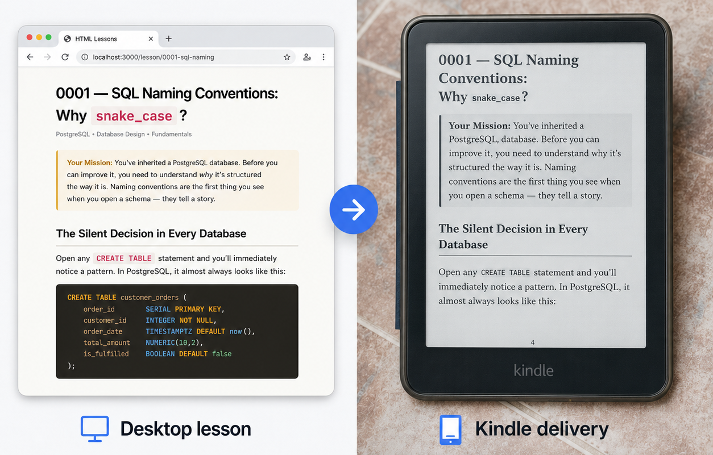

<p align="center">
  
</p>

# Learn Anything. Review Anywhere.

Two AI agent skills, one repo. **`/teach`** turns any topic into interactive HTML lessons. **`/kindle-sync`** compiles them into a Kindle book and delivers it to your device.

Built for [Matt Pocock's skills-for-AI-agents](https://github.com/mattpocock/skills) framework.

<p align="center">
  
</p>


---

## What's Inside

| | |
|---|---|
| `skills/teach/SKILL.md` | Agent skill: generates interactive lessons |
| `skills/kindle-sync/SKILL.md` | Agent skill: syncs lessons to Kindle |
| `kindle_sync.py` | The `kindle-sync` CLI: builds the book (PDF or EPUB) and emails it |
| `workspace-template/` | Scaffolding: copy it to start learning anything |
| `demo-workspace/` | Working example: a PostgreSQL lesson, ready to sync |

---

## Quick Start

```bash
# 1. Install the CLI
uv tool install git+https://github.com/zura1555/kindle-sync   # or: pipx install git+https://github.com/zura1555/kindle-sync
# PDF output needs Pango (EPUB does not):
#   Ubuntu: sudo apt install libpango-1.0-0 libpangoft2-1.0-0
#   macOS:  brew install pango

# 2. Install the skills into your agent's skills directory
cp -r skills/teach skills/kindle-sync ~/.claude/skills/        # Claude Code
cp -r skills/teach skills/kindle-sync ~/.config/agents/skills/ # Amp

# 3. Scaffold a workspace
cp -r workspace-template ~/my-learning && cd ~/my-learning

# 4. Configure Kindle delivery (here, or once in ~/.kindle-creds for every workspace)
cp /path/to/kindle-sync/.kindle-creds.example .kindle-creds && chmod 600 .kindle-creds
# Fill in: KINDLE_EMAIL, SENDER_EMAIL, SMTP_PASSWORD
```

You need three things:

| Credential | Where to get it |
|---|---|
| **Kindle email** | [amazon.com/myk](https://amazon.com/myk) → Devices → Kindle → Send-to-Kindle Email |
| **App password** | [myaccount.google.com/apppasswords](https://myaccount.google.com/apppasswords) (2FA required). Other providers: set `SMTP_HOST`, `SMTP_PORT`, `SMTP_USER` |
| **Approved sender** | Add your sender address in Amazon's Personal Document Settings |

Credentials can also come from environment variables with the same names.

```bash
# 5. Learn and sync
/teach me PostgreSQL     # Agent generates lessons
kindle-sync sync         # → appears on your Kindle in ~5 min
```

---

## How It Works

`kindle-sync` compiles all `lessons/[0-9]*.html` and `reference/*.html` into one book in `lessons/kindle-output/`, then emails it to your Kindle.

| Command | |
|---|---|
| `kindle-sync build` | Build the book only |
| `kindle-sync send` | Email the built book |
| `kindle-sync sync` | Build, then send if any lesson changed since the last send (`--force` sends anyway) |

- **Formats:** the default is a 4.5×6in PDF with a clickable contents page. `--format epub` makes a reflowable EPUB, so font size, dictionary, and highlights work on the Kindle.
- **Title:** taken from `# Mission: <Topic>` in `MISSION.md`. Override it with `--title`.
- **Quizzes:** scripts are stripped, quiz options become a lettered list, and the answers move to an answer key at the end of each chapter, so you can still practise retrieval offline.

Lessons follow a structured pedagogy: knowledge first, an interactive quiz with immediate feedback, a primary source citation, and a reminder to ask the agent follow-up questions.

---

## Try the Demo

```bash
kindle-sync build --workspace demo-workspace
# → demo-workspace/lessons/kindle-output/postgresql.pdf
```

---

## Development

```bash
pip install -e ".[test]" && pytest
```

---

## Safety

- `.kindle-creds` is gitignored and `chmod 600` — never committed
- Skill definitions instruct agents to **never read or expose** credential contents

---

MIT — see [LICENSE](LICENSE).
